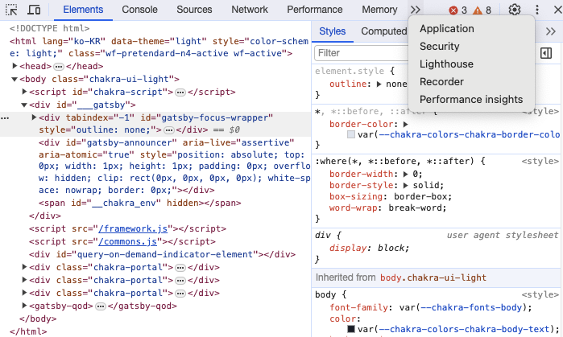
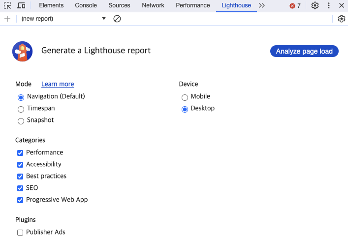
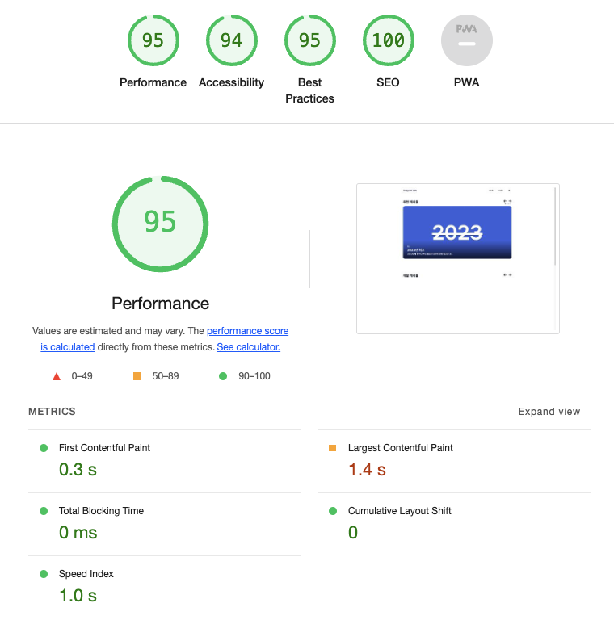
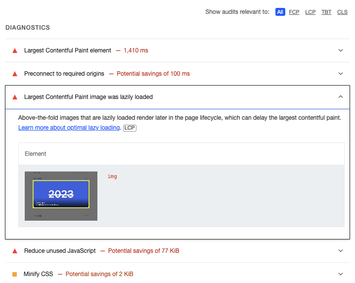
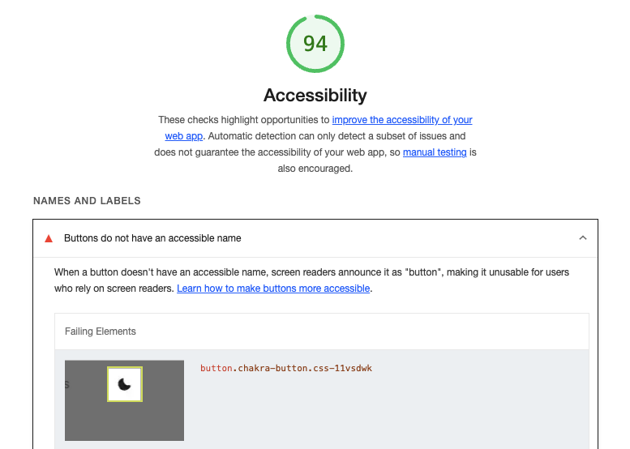

# tl;dr

Gatsby로 만든 블로그를 더 개선하기 위해 Chrome 개발자 도구인 Lighthouse를 활용했다. 성능과 접근성 등의 점수를 살펴보고, LCP와 버튼의 접근성 이름처럼 개선이 필요한 부분을 찾았다. 점수만 보는 것보다 **각 지표가 무엇을 의미하고, 내 블로그에서 어떤 부분을 살펴봐야 하는지** 알아가는 과정이었다.

> 화면과 점수는 2024년 작성 당시를 기준으로 합니다.

# 지난 이야기
&nbsp;SEO에 유리해야 하고 렌더링 속도가 빨라야 하는 등의 여러 가지 기준을 통해 Gatsby를 사용하여 블로그를 만들게 되고 한 가지 생각을 하게 됩니다.

# 만든 블로그를 더욱 발전시킬 수 없을까?
&nbsp;좋은 블로그라고 하면 어떤 블로그가 좋은 블로그일까요? UI/UX가 훌륭한, 양질의 게시물이 많이 있는 개개인의 기준으로 좋은 블로그를 판단하는 요소는 여러 가지가 있을 것이기
때문에 사람마다 다를 겁니다. 그러면 좋은 블로그가 되기 위해 **내 블로그의 문제점과 개선할 수 있는 부분을 찾아 발전할 수 있는 방법**이 있다면 어떨까요? 오늘은 Lighthouse로 블로그를 측정하고 진단 항목을 읽는 과정을 소개하려 합니다.

# Chrome Lighthouse
&nbsp;Chrome에는 Lighthouse라는 이름의 개발자 도구가 있습니다. 웹 페이지 품질 개선을 위한 오픈소스 자동화 도구로, **성능, 접근성, Best Practices, SEO 등을 검사하고 개선할 부분을 알려줍니다**. 사용 방법은 다음과 같습니다.

# 시작

&nbsp;사용법은 간단합니다. 준비물로 Google Chrome 브라우저만 있으면 됩니다. 개발자분들이라면 한 번쯤은 사용해 보셨을 개발자 도구 창을 열어 >> 버튼을 누르면
Lighthouse를 확인할 수 있습니다.

&nbsp;Lighthouse 버튼을 누르면 다음과 같은 화면이 나오게 되는데요. 여기서 Mode, Device, Categories 세 가지 분류로 여러 선택지가 있는 걸 확인할 수 있는데,
해당 분류들은 다음과 같습니다.

## Mode

- Navigation: **페이지를 처음 로드할 때의 성능을 측정**. 페이지가 로드될 때, 네트워크 요청, 렌더링 속도, 사용자가 사용할 수 있기 전까지 지연되는 시간과 같은 지표를 제공합니다.
- Timespan: **기록을 시작하고 끝낼 때까지의 구간을 검사**. 버튼을 클릭하거나 화면을 전환하는 동안 발생한 TBT, CLS 등을 확인할 때 사용합니다.
- Snapshot: **현재 페이지 상태를 새로고침 없이 검사**. 모달을 연 상태의 접근성처럼 특정 화면을 점검할 때 사용합니다.

모드별 검사 범위는 [Lighthouse 사용자 흐름 문서](https://github.com/GoogleChrome/lighthouse/blob/main/docs/user-flows.md)에서 확인할 수 있습니다.

## Categories

- Performance: **웹 페이지의 성능 관련 지표**. 페이지 로딩 시간, 리소스 최적화, 렌더링 속도와 같은 성능 관련 지표를 제공합니다.
- Accessibility: **웹 접근성 관련 지표**. 시각, 청각과 같은 사용에 제약이 있는 사용자가 해당 웹 페이지를 잘 사용할 수 있는지를 확인하며, HTML 태그, 대체 텍스트와 같은 웹 접근성 항목을 확인합니다.
- Best Practices: **웹 개발 관행을 제대로 따랐는지에 대한 지표**. 웹 애플리케이션의 안정성과 효율성을 위해, 보안, 성능 최적화 등에 대한 웹 개발 가이드라인을 제대로 준수하고 있는지 확인합니다. 
- SEO: **검색 엔진이 페이지를 읽는 데 필요한 기본 항목 검사**. 메타 태그나 크롤링 가능 여부 등을 확인합니다.
- Progressive Web App: **설치 가능성 등 PWA 관련 항목 검사**. 작성 당시 제공되던 항목으로, 현재는 [Lighthouse에서 제거되었습니다](https://developer.chrome.com/docs/lighthouse/pwa/themed-omnibox).

## Device

&nbsp;Mobile과 Desktop은 **어떤 기기 환경에서 검사할지 선택하는 항목**입니다. Mobile을 선택하면 모바일 화면과 성능 조건을 시뮬레이션해 검사합니다.

# 측정

&nbsp;이제 Analyze page load 버튼을 눌러 측정을 시작하면 결과가 나오게 됩니다.

제 블로그의 메인 페이지를 대상으로 측정했으며 Performance 95점, Accessibility 94점, Best Practices 95점, SEO는 100점이지만 사용자 환경에 따라 점수는 측정할 때마다 소폭 달라질 수 있습니다.
**Performance는 다른 지표와 달리 측정 지표에도 5가지 지표**가 존재하고 지표로는 First Contentful Paint, Largest Contentful Paint, Total Blocking Time, Cumulative Layout Shift, Speed Index가 있으며 각 지표는 다음과 같습니다.

- First Contentful Paint: **페이지 로드 시작부터 첫 텍스트나 이미지 등의 콘텐츠가 그려질 때까지의 시간**
- Largest Contentful Paint: **화면에 보이는 영역에서 가장 큰 이미지나 텍스트 블록이 렌더링될 때까지의 시간**
- Total Blocking Time: **측정 구간의 긴 메인 스레드 작업 중 50ms를 초과한 부분을 합산한 시간**. 일반적인 Lighthouse 로드 검사에서는 FCP부터 TTI까지를 대상으로 합니다.
- Speed Index: **웹 페이지의 전체적인 시각적 로딩 속도**
- Cumulative Layout Shift: **예상치 못한 레이아웃 이동으로 인한 시각적 불안정성을 나타내는 점수**. 페이지를 불러올 때나 사용하는 도중에 콘텐츠가 갑자기 밀리는 경우를 생각하면 됩니다.

이 중 [Core Web Vitals](https://web.dev/articles/vitals)에 해당하는 지표는 LCP와 CLS이며, 상호작용 응답성을 나타내는 INP까지 세 가지로 구성됩니다. TBT는 INP와 관련된 문제를 실험실 환경에서 살펴볼 때 사용하는 보조 지표입니다.

# 개선 지점 확인

&nbsp;점수 아래의 진단 항목을 보면 어떤 부분을 추가로 조사하면 좋을지 알 수 있습니다. 제안된 항목을 수정한 뒤에는 같은 조건에서 다시 측정해야 실제 개선 여부를 판단할 수 있습니다.

측정에서 나온 것처럼 Largest Contentful Paint에서 소요되는 시간이 많은데 페이지의 어떤 요소가 시간을 많이 걸리게 하는지 알려줍니다.
이는 Performance뿐만 아니라 Accessibility 지표에서도 확인할 수 있는데

접근성을 높이려면 다음과 같은 버튼에 accessible name을 설정하라고 알려주며 Best Practices, SEO에서도 이와 비슷한 진단을 확인할 수 있습니다.

# 마치며

&nbsp;지금까지 사이트 개선을 위한 방법 중 하나인 Chrome의 Lighthouse를 알아보았습니다. Lighthouse가 **사이트의 좋고 나쁨을 판단하는 절대적인 지표는 아니며**
자신이 만든 사이트를 개선하고 싶을 때, 참고하기 좋은 참고서 정도로 사용하면 좋은 것 같습니다. 지금까지 긴 글 읽어주셔서 감사합니다.
