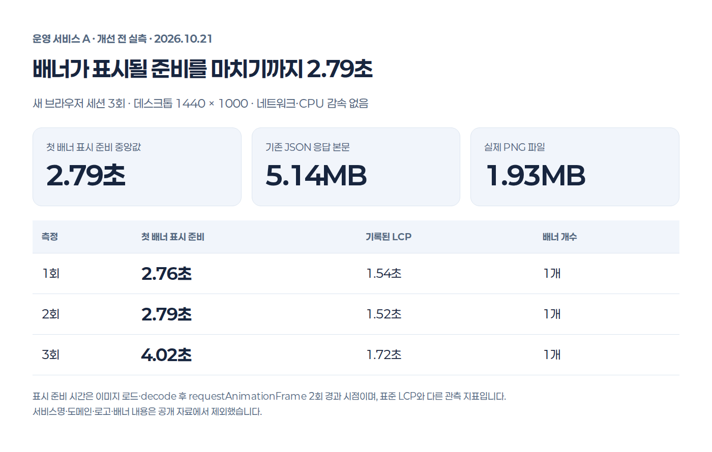
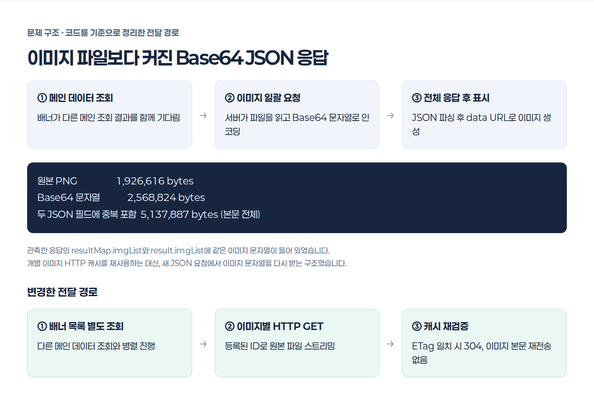
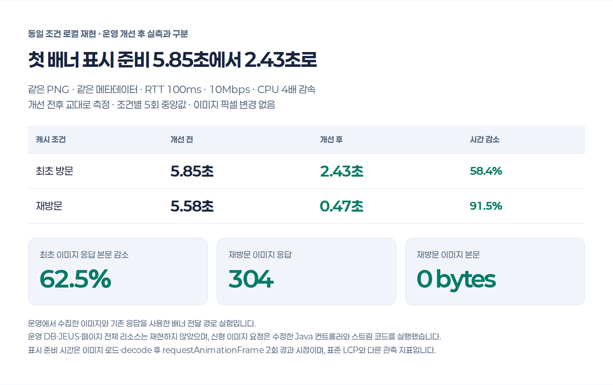
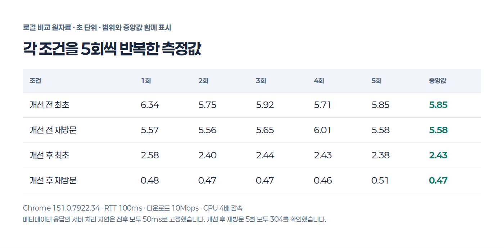

운영 중인 웹 서비스의 메인 배너를 살펴보다가 이미지가 화면의 다른 요소보다 늦게 나타나는 것을 확인했습니다. 배너 파일의 크기와 함께, 브라우저가 이미지를 요청하고 표시하기까지 어떤 단계를 거치는지 살펴봤습니다.

확인한 구조는 **메인 데이터 조회 → 이미지 일괄 요청 → Base64 JSON 수신 → 이미지 생성**이었습니다. 이미지 한 장의 원본은 약 1.93MB였는데, 이미지 응답 본문은 약 5.14MB였습니다. Base64 인코딩에 더해 같은 문자열이 JSON의 두 필드에 들어가고 있었습니다.

이번에는 원본 이미지의 픽셀을 유지하면서 **이미지별 GET과 HTTP 캐시 재검증**을 적용했습니다. 아래에는 운영 화면의 개선 전 실측과 변경 코드를 실행한 로컬 비교를 나누어 기록했습니다. 서비스명·도메인·로고·실제 배너 내용은 공개 자료에서 제외했습니다. 현재는 코드 수정과 로컬 검증까지 마친 상태이며, 운영 반영 후 결과는 별도로 측정할 예정입니다.

# 먼저 현재 화면을 측정했다

새 브라우저 세션을 열어 같은 운영 화면을 3회 측정했습니다. 화면 크기는 1440 × 1000이고, 네트워크나 CPU 감속은 적용하지 않았습니다.

| 측정 | 첫 배너 표시 준비 | 기록된 LCP |
| --- | --- | --- |
| 1회 | 2.76초 | 1.54초 |
| 2회 | 2.79초 | 1.52초 |
| 3회 | 4.02초 | 1.72초 |

**첫 배너 표시 준비 시간의 중앙값은 2.79초**였습니다. 이 값은 탐색 시작부터 첫 배너 이미지가 로드되고 `decode()`를 마친 뒤, `requestAnimationFrame` 두 번을 거친 시점까지입니다. 브라우저의 표준 페인트 지표인 LCP와는 별도로 관측한 값입니다.

기록된 LCP와 배너 표시 준비 시간이 일치하지 않았기 때문에, 이번 변경의 목표는 배너에 직접 연결된 지표로 확인했습니다. [LCP를 개선할 때도 리소스 요청 지연과 다운로드 시간, 렌더 지연을 구분해서 살펴볼 필요가 있습니다.](https://web.dev/articles/optimize-lcp)



# 원본보다 커진 이미지 응답

메인 배너는 다른 메인 데이터와 함께 목록을 조회했습니다. 그 요청이 끝나면 배너의 파일 목록으로 추가 요청을 보냈고, 서버는 모든 파일을 읽어 Base64 문자열 배열로 반환했습니다. 브라우저는 JSON을 받은 다음에야 이미지 요소를 만들었습니다.

다음 코드는 식별 정보를 제거하고 흐름만 남긴 예시입니다.

```javascript
fetchMainData().then((data) => {
  fetchBannerImages(data.banners).then((response) => {
    response.result.imgList.forEach((dataUrl) => {
      const image = document.createElement("img");
      image.src = dataUrl;
      bannerWrapper.append(image);
    });
  });
});
```

측정 당시 배너는 PNG 한 장이었습니다. 응답 본문과 디코딩한 원본 파일을 대조한 결과는 다음과 같습니다.

| 대상 | 크기 |
| --- | ---: |
| 원본 PNG | 1,926,616 bytes |
| 이미지 한 장의 Base64 문자열 | 2,568,824 bytes |
| 기존 JSON 응답 본문 전체 | 5,137,887 bytes |

Base64는 3바이트를 4문자로 표현하므로 이 파일의 문자열 길이는 원본의 약 4/3이 됩니다. 여기에 실제 응답에서는 **`resultMap.imgList`와 `result.imgList` 양쪽에 같은 이미지 문자열**이 들어 있었습니다. 두 문자열만 합쳐도 5,137,648바이트이고, JSON 구조까지 포함하면 위의 응답 크기가 됩니다.

이 구조에서는 배너를 다시 조회할 때 새 JSON 응답에 이미지 데이터가 다시 포함됩니다. 이미지마다 독립적인 HTTP 캐시를 재검증하는 경로도 사용하지 않고 있었습니다.



# 배너 조회와 이미지 전송을 바꿨다

## 배너 목록을 다른 메인 조회에서 분리

메인 배너 목록을 별도 요청으로 분리하고, 나머지 메인 데이터와 병렬로 조회하도록 바꿨습니다. 배너에 필요한 정보가 준비되면 이미지 요청을 시작할 수 있습니다.

## 이미지 요소에 GET 주소를 바로 설정

목록 응답에는 배너 ID와 파일 ID 등의 메타데이터만 사용합니다. 브라우저는 각 이미지의 주소를 받아 직접 요청하고, 서버는 등록된 파일을 스트림으로 전송합니다. 파일 전체를 Base64 문자열로 만들거나 이미지 데이터를 JSON에 넣는 단계를 없앴습니다.

```javascript
fetchBannerList().then((banners) => {
  banners.forEach((banner, index) => {
    const image = document.createElement("img");
    image.alt = banner.description || "배너 이미지";
    image.loading = index === 0 ? "eager" : "lazy";
    image.fetchPriority = index === 0 ? "high" : "low";
    image.decoding = "async";
    image.src = buildBannerImageUrl(banner);
    bannerWrapper.append(image);
  });
});
```

첫 배너는 바로 요청하고 이후 배너에는 지연 로딩을 적용했습니다. `fetchpriority`는 요청 우선순위에 대한 힌트이므로, 우선순위 속성만으로 속도가 보장된다고 해석하지는 않았습니다. [우선순위보다 먼저 이미지를 발견하고 요청할 수 있는 경로를 만드는 것이 중요합니다.](https://web.dev/articles/optimize-lcp)

URL에는 배너 ID와 파일 ID, 파일 변경을 구분할 버전을 넣었습니다. 서버의 물리 경로나 임의의 쿼리 이름은 받지 않습니다. 서버가 고정된 조회로 등록 파일을 찾고, 공개 화면에서는 활성 여부·게시 기간·삭제 여부를 확인합니다. 누락되거나 읽을 수 없는 파일은 오류 응답을 보내고 화면에서는 대체 이미지를 표시합니다.

## 재방문에는 캐시를 재검증

공개 배너에는 다음 정책을 적용했습니다.

```http
Cache-Control: public, max-age=0, must-revalidate
ETag: W/"image-version"
Last-Modified: ...
```

`max-age=0`으로 즉시 오래된 응답으로 간주하고, 사용할 때 서버에 다시 검증하도록 했습니다. 파일이 바뀌지 않았다면 **304 응답으로 이미지 본문을 다시 보내지 않습니다.** 공개 여부 확인은 캐시 조건을 처리하기 전에 수행합니다. [HTTP 캐시 재검증은 저장된 응답을 다시 사용할 수 있는지 확인하는 절차입니다.](https://httpwg.org/specs/rfc9111.html#validation)

관리자 배너 미리보기도 같은 GET 방식으로 바꿨습니다. 관리 화면은 로그인·접속 IP·메뉴 조회 권한 검사를 유지하고 `Cache-Control: private, no-cache`를 사용합니다. 아직 공개되지 않은 배너가 공유 캐시에 들어가지 않도록 공개 화면과 정책을 나눴습니다.

# 같은 조건에서 변경 전후를 비교했다

운영 개선 전의 2.79초와 로컬 개선 후의 값을 직접 비교하면 실행 환경의 차이가 섞입니다. 전후 비교에는 별도의 로컬 재현 환경을 사용했습니다.

| 항목 | 조건 |
| --- | --- |
| 브라우저 | Chrome 151.0.7922.34 |
| 화면 | 1440 × 1000 |
| 네트워크 | RTT 100ms, 다운로드 10Mbps, 업로드 5Mbps |
| CPU | 4배 감속 |
| 원본 이미지 | 같은 PNG, 1672 × 941, 픽셀 변경 없음 |
| 메타데이터 처리 | 전후 동일한 응답과 서버 지연 50ms |
| 반복 | 전후 순서를 교대하며 조건별 5회 |

변경 전은 기존 이미지 JSON 응답을 그대로 사용했습니다. 변경 후 이미지 요청은 **수정한 Java 컨트롤러와 스트림 코드**를 실행했고, 파일 메타데이터는 고정된 테스트 값으로 공급했습니다. 화면 코드는 수정 전후 JSP의 배너 함수를 가져와 실행했습니다.

이 실험은 배너 전달 경로에 범위를 둔 비교입니다. 운영 DB와 JEUS, 메인 페이지의 전체 리소스, 슬라이더 초기화 비용은 재현하지 않았습니다. 따라서 아래 값은 **운영 배포 후의 성능이나 페이지 전체의 개선율을 뜻하지 않습니다.**

| 캐시 조건 | 개선 전 중앙값 | 개선 후 중앙값 | 시간 감소 |
| --- | ---: | ---: | ---: |
| 최초 방문 | 5.85초 | 2.43초 | 58.4% |
| 재방문 | 5.58초 | 0.47초 | 91.5% |

첫 이미지 응답 본문은 약 5.14MB에서 1.93MB로 **62.5% 감소**했습니다. 원본 이미지 자체를 바꾸지 않은 상태의 결과입니다. 변경 후 재방문은 5회 모두 304였고, 이미지 본문은 전송하지 않았습니다. 표의 재방문 시간에는 목록 조회와 캐시 재검증에 걸리는 시간도 포함됩니다.





## 기능과 접근 조건도 확인

공개 화면과 관리자 화면을 각각 Java 8 대상으로 컴파일하고, H2의 PostgreSQL 호환 모드에서 실제 MyBatis 매퍼와 컨트롤러를 테스트했습니다. 두 프로젝트에서 총 22개 테스트가 통과했습니다.

공개되지 않은 배너와 삭제된 파일이 노출되지 않는지, 관리자 세션과 메뉴 권한이 없는 요청이 차단되는지 확인했습니다. 원본 PNG와 응답 바이트의 일치, ETag 재검증, HEAD 응답, 잘못된 ID, 누락 파일, 이미지가 아닌 내용, 등록 경로 밖을 가리키는 심볼릭 링크도 검사했습니다.

브라우저 비교에서는 전후 이미지의 원본 크기가 동일한지와 JavaScript 오류가 없는지 확인했습니다. 테스트 DB 검증과 별개로 운영 PostgreSQL의 실행 계획과 JEUS·프록시를 통과한 캐시 동작은 배포 환경에서 확인해야 합니다.

# 운영 반영 뒤 확인할 항목

다음 검증은 실제 배포 환경에서 같은 조건으로 반복할 예정입니다. 두 WAS에 같은 변경을 반영한 뒤, 각 서버의 최초 방문과 재방문을 확인하고 이미지 응답의 MIME 타입·ETag·304 처리, 관리자 미리보기 권한과 게시 기간 경계도 점검하려고 합니다.

이번 작업으로 확인한 것은 원본 PNG를 유지해도 **Base64 인코딩과 중복 JSON 직렬화를 없애고 이미지 캐시를 재사용하면 전송량과 표시 대기를 줄일 수 있다**는 점입니다. 원본 이미지 최적화와 페이지 전체의 LCP 개선은 이 변경을 운영에서 확인한 뒤 이어서 살펴보겠습니다.
