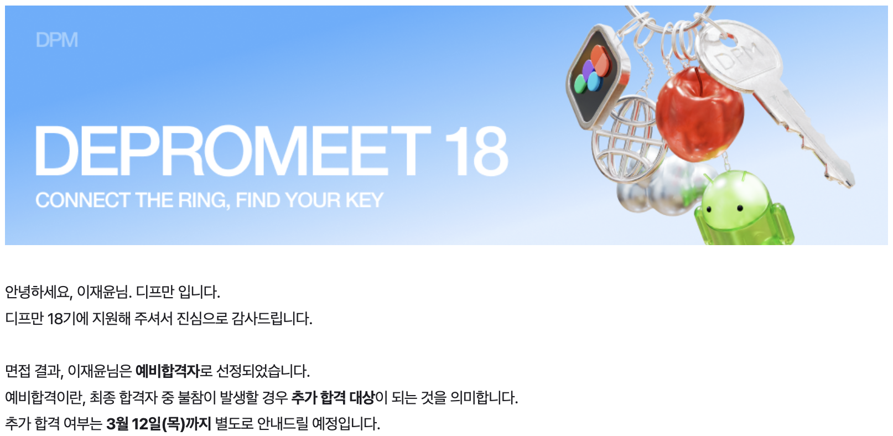
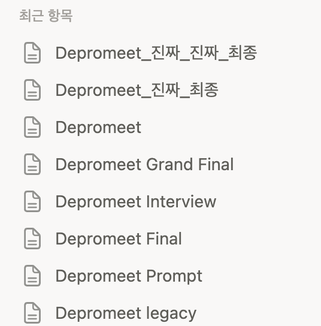
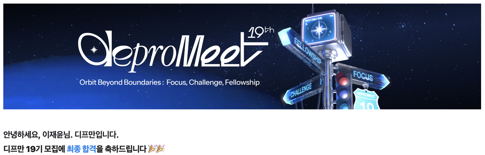
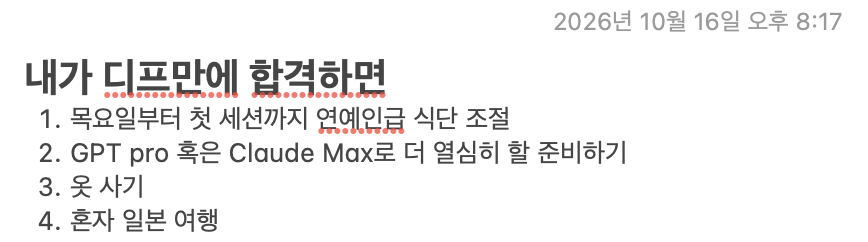

# tl;dr

- 디프만 18기에서 예비 합격 후 최종 합격하지 못했지만, 다시 도전해 19기에 합격했다.
- 예상 질문마다 답변을 준비하는 것에서 나아가, 내 경험과 선택 이유를 내 말로 설명하는 방향으로 준비했다.
- 면접에서는 충분히 이해하지 못한 블로그 내용을 설명하지 못했다. AI의 도움을 받더라도 내 이름으로 올린 글에는 내가 책임져야 한다는 점을 느꼈다.
- 이제는 동료들과 서비스를 만들고, 실제 사용자의 피드백을 받아 개선하는 경험을 남기고 싶다.

# 첫 시작은 이러했다.

&nbsp;부트캠프에서는 팀 프로젝트와 개인 프로젝트를 진행했고, 취업 이후에도 혼자 프로젝트를 만들었다. 만드는 경험은 쌓였지만 해소되지 않는 갈증이 있었다. **실제 서비스 사용자의 피드백을 받아 개선한 경험이 부족하다는 것**이었다.

&nbsp;혼자서 불편을 발견하고 해결하는 것도 즐거웠지만, 다른 사람이 내 서비스를 사용하면 어떤 생각을 할지 궁금했다. 내가 편하다고 생각한 기능이 다른 사람에게도 편할까? 내가 발견하지 못한 불편은 없을까? 동료들과 서비스를 만들고 실제 사용자에게 검증받는 경험을 하고 싶었다. 그렇게 관심을 갖게 된 곳이 디프만이었다.

# 처음 지원한 18기

&nbsp;프로젝트와 아르바이트 경험을 바탕으로 열심히 서류를 작성했고, 서류에 합격해 면접을 준비했다. 공들이는 시간이 많아져서였을까. 준비할수록 디프만을 향한 짝사랑은 더욱 커져갔다. 운영진의 후기를 읽고는 자기소개에 운영진이 되고 싶다는 포부까지 넣었다. 아직 활동을 시작하지도 않았는데 운영진부터 꿈꾸고 있었다.

&nbsp;이전 기수의 합격 후기, 공식 사이트의 인재상, 디프만 블로그까지 전수 조사에 가까울 정도로 읽고 예상 질문과 답변을 만들었다. 나름 만반의 준비를 했다고 생각했다.

&nbsp;하지만 면접에서는 내가 사용한 기술 외에 어떤 대안이 있었는지 묻는 질문에 막혔다. 프론트엔드 질문에 답하면서 꺼낸 키워드도, 그 의미와 차이를 다시 물으시자 제대로 설명하지 못했다. **내가 먼저 꺼낸 키워드였는데도 불구하고**. 그 외에는 잘 답변했다고 생각해서 나름 기대했다. 그리고…

&nbsp;예비 합격을 받았다. 이전 기수에서 예비 합격 후 추가 합격했다는 후기들을 읽었기에 회사에서도 자주 휴대폰을 확인했다. 하지만 끝내 추가 합격 연락은 오지 않았다.

&nbsp;연락을 기다리며 휴대폰을 들여다보고, 디프만 깃허브 계정의 developer 멤버들을 보며 마음이 미어지기도 했다. 돌이켜보면 다른 건 몰라도 디프만에 진심이었구나 싶다.

# 다시 도전한 19기

## 서류부터 면접까지

&nbsp;2월에 입사해서 나름 회사 생활이 익숙해졌다고 느껴질 때쯤 메일이 왔다. 19기를 모집한다는 메일이었다. 18기에 떨어져도 내 마음은 전과 같았다. 서비스 사용자의 피드백을 받아 개선해보는 프로젝트를 만들고 싶었다. 거기에 추가로 동료 개발자들은 AI를 어떻게 사용하는지 서로 공유해보고 싶었다. 그래서 다시 도전했다.

## 18기와 19기를 준비하며 느꼈던 유사한 점과 다른 점

### 서류에서

&nbsp;내가 지원한 Web Developer 직군의 서류 문항은 두 기수가 대체로 비슷했고, 한 문항 정도 차이가 있었다. 18기에서는 여러 번의 시행착오 끝에 구현에 성공한 기능을 물었다면, 19기에서는 프론트엔드 개발자로서 협업할 때 중요하게 생각하는 원칙과 태도를 물었다.

&nbsp;이전에 정리했던 경험에 그동안 쌓인 경험을 더해 작성했다. 처음 지원할 때보다는 덜 막막했고, 이번에도 서류에 합격했다.

### 서류 합격 후 면접 전까지

&nbsp;한 번 면접을 봤으니 처음보다는 덜 막막했다. 그렇다고 방심할 수는 없었다. 18기에는 예상 질문을 많이 만들고 답변을 준비했지만, 내가 사용한 기술의 다른 대안이나 답변 중 꺼낸 키워드를 깊게 물어보면 막혔다. **준비한 질문에 답하는 것과 내 경험을 설명하는 것**은 다르다는 걸 느꼈다.

&nbsp;이번에도 처음에는 자기소개, 기술, 협업, AI까지 예상 질문을 계속 늘려갔다. 그런데 회사를 다니며 모든 질문을 준비하기에는 한계가 있었다. 그래서 질문마다 답변을 만드는 것에 더해, 여러 질문에 꺼내 쓸 수 있는 경험을 정리하는 쪽으로 준비 방향을 바꿨다. 라디오 프로젝트에서 광고 판별 방식을 바꾼 경험, 접근성 도구를 만든 경험, 해커톤에서 배포가 막혀 로컬 시연으로 전환한 경험이 중심이었다. 각각 어떤 문제가 있었고, 내가 무엇을 했으며, 왜 그렇게 선택했고, 무엇까지 확인했는지를 정리하려 했다.

&nbsp;물론 틀을 안다고 정리가 바로 되는 건 아니었다. 경험은 고를 수 있었지만 내 역할과 선택 이유를 나눠 설명하는 것부터 어려웠다. AI와 대화하며 서류와 포트폴리오를 경험별로 나누고, 기억이 흐릿하거나 설명이 막히는 부분을 확인했다. 이 과정에서 HTTPS 페이지에서 HTTP API를 호출할 때의 혼합 콘텐츠 문제와 CORS를 구분하는 등, 내가 안다고 생각했던 개념도 다시 짚었다.

&nbsp;자기소개 역시 처음에는 나를 어떤 개발자라고 표현해야 할지 막막했다. 그러다 최근 만든 운동 기록 서비스와 개인 디자인 시스템을 돌아보며, 나는 생활 속 불편을 개발로 해결할 때 즐거움을 느끼는 사람이라는 말이 나왔다. 디프만에서 얻고 싶은 것도 사용자 피드백을 통한 개선 경험에 더해, 동료들과 AI 활용 과정에서의 판단과 검증 기준을 나누는 것으로 구체화했다.

&nbsp;돌아보면 준비의 중심을 조금은 바꾼 셈이다. 예상 질문의 수를 늘리는 것만큼, 내가 적은 문장과 내가 했던 선택을 내 말로 설명할 수 있는지가 중요했다. 다만 실제 면접에서는, 그렇게 준비하고도 충분히 확인하지 못한 부분이 드러났다.

### 면접 과정과 면접을 보고 나서

&nbsp;내가 받은 질문을 기준으로, 18기에는 협업 상황에 관한 질문이 주를 이뤘고 프로젝트와 프론트엔드 관련 질문을 받았다. 19기에는 프로젝트 관련 질문이 더 많았다. 예상했던 질문과 다른 방향으로 물으셔서 답변은 했지만, 긴장하고 당황한 탓에 말이 장황해졌다.

&nbsp;기술 블로그에 쓴 내용에 대해서도 질문을 받았다. Astro가 Gatsby보다 SEO에 유리하다고 적은 이유를 물으셨는데, 그 자리에서 제대로 설명하지 못했다. Astro의 SEO 측정 지표를 보고 써보고 싶었다는 답변에 그쳤다. 왜 그런 비교를 했는지에 대한 충분한 설명이 아니었다.

&nbsp;AI의 도움을 받아 작성한 내용이었지만, 내 이름으로 올린 글인 만큼 내가 이해하고 설명할 수 있어야 했다. 면접에서 답하지 못한 것도 아쉬웠지만, 충분히 이해하지 못한 문장을 내 글로 게시했다는 점이 더 부끄러웠다.

## 최종 결과는?

&nbsp;면접에서 내가 기대하고 준비한 만큼 보여주지 못했다고 생각했다. 끝나고 나니 답하지 못했던 질문과 장황하게 말했던 순간이 계속 떠올랐다. 결과 발표일까지 하루에 한 번은 디프만을 생각하며, 이번에도 떨어질 것 같다는 생각에 괜스레 우울해졌다. 매일 창모의 빌었어를 들으며 머리론 불합격을 예감하지만 가슴으론 절실히 합격을 빌었다.

&nbsp;발표 당일에는 정오부터 가슴이 답답할 만큼 긴장했다. 그렇게 지난번처럼 오후 두 시에 도착한 메일을 확인했는데…

&nbsp;최종 합격을 받았다.

# 내 욕심과 포부

&nbsp;사실 면접 전날부터 합격하면 무엇을 할지 적어뒀다. 18기 자기소개에서 운영진이 되고 싶다고 말했던 것처럼, 이번에도 하고 싶은 게 참 많다.

&nbsp;가장 먼저 이루고 싶은 것은 지원할 때부터 말했던 목표다. **사용자가 불편해하는 지점을 발견하고, 팀과 우선순위를 정해 개선한 경험**을 남기고 싶다. 동료들과 AI 활용 방식과 시행착오도 나누며, 서로의 선택 이유를 편하게 묻고 설명할 수 있는 팀을 함께 만들어가고 싶다. 가능하다면 기수가 끝난 뒤에도 서비스를 계속 운영하고 싶다.

&nbsp;프로젝트뿐 아니라 디프만의 활동에도 적극적으로 참여하고 싶다. 대학교에서 학생회를 할 때, 열심히 준비한 행사에 반응이 미지근하면 많이 아쉬웠다. 준비하는 사람의 마음을 조금은 알기에, 이제는 참여하는 입장에서 호응하고 함께 즐기는 사람이 되고 싶다.

&nbsp;들어가고 싶었던 만큼 열심히 참여하고, 수료할 때는 내가 무엇을 얻으러 왔고 무엇을 얻었는지 실제 경험으로 이야기할 수 있었으면 좋겠다.

# 넘어져도, 떨어져도 다시 일어나고 도전하는 사람

&nbsp;합격한 기쁨으로 쓰기 시작한 글을 마치며, 나는 어떤 사람이 되고 싶은지 다시 생각해본다. 넘어져도, 떨어져도 다시 일어나고 도전하는 사람이 되고 싶다.

&nbsp;대학교 입시, 영화관 아르바이트, 이번 디프만까지. 원하는 결과를 바로 얻지 못한 일들이 있었다. 그럴 때마다 담담했던 건 아니다. 부정적인 생각으로 가득 차기도 했고, 자존심이 상하기도 했다. 그래도 시간이 지나면 다시 의자에 앉아 도전했다.

&nbsp;이번에도 그랬다. 18기에서 떨어졌을 때 많이 힘들었지만, 다음 모집 소식을 보고 다시 지원했다. 그리고 이번에는 합격했다.

&nbsp;다만 앞으로는 도전하는 것만큼, 원하는 결과를 얻지 못했을 때나 결과를 기다리는 동안 나를 지나치게 몰아붙이지 않는 법도 배우고 싶다. 아쉬운 점은 돌아보되, 그동안 기울인 노력까지 없던 일로 만들지는 않으면서.

&nbsp;앞으로도 넘어질 수 있겠지만, 다시 도전하며 살아가야지.
